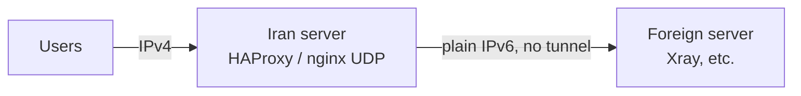

# HAProxy IPv4 → IPv6 Forwarder

[English](#english) | [فارسی](#فارسی)

Forwards TCP and UDP ports from an Iran server's IPv4 address to a foreign server's IPv6 address, with **no tunnel**. It is set up from a single interactive script and runs only on the Iran server.



> Need a tunnel between the two servers instead? See [haproxy-gre6-tunnel](https://github.com/Arash-Ariaye/haproxy-gre6-tunnel).

---

## English

### Features

- **Simple setup:** runs on the Iran server only. Nothing has to be installed on the foreign server.
- **TCP through HAProxy:** zero-copy kernel splice, and reloads that keep existing connections.
- **UDP through nginx stream:** a dedicated `haproxy-forwarder-udp` service, separate from any nginx web server you already run.
- **Optional PROXY protocol v2:** lets the foreign server see users' real IPs. Optional health checks are also available.
- **Flexible ports:** forward a port to the same port on the foreign server (`443,8443`) or to a different one (`4040=443`).
- **Safe changes:** every change is validated before it is applied, backed up, and rolled back automatically if the services fail to start.
- **Repairs itself:** a timer checks everything after boot and every minute, and rebuilds the configuration from the saved rules if anything is broken.
- **Monitoring:** live traffic per port, connection counts, traffic totals, and network tuning (BBR, buffers, limits).
- **Missing packages are installed for you:** HAProxy, nginx (only when UDP is used) and nftables. On Ubuntu you can optionally install HAProxy 3.0 LTS from the official PPA.

### Requirements

| | |
|---|---|
| OS | Debian or Ubuntu with systemd, run as root |
| Iran server | IPv4 for users and **working outbound IPv6** |
| Foreign server | An IPv6 address, with its services listening on IPv6 (`[::]` or all addresses) |

### Install and run

Run on the **Iran server**:

```bash
curl -fsSL https://raw.githubusercontent.com/Arash-Ariaye/haproxy-ipv6-forwarder/main/HAProxy.sh -o /tmp/forwarder.sh && bash /tmp/forwarder.sh
```

If you're not root, use `sudo bash /tmp/forwarder.sh`. If `curl` is missing:

```bash
wget -qO /tmp/forwarder.sh https://raw.githubusercontent.com/Arash-Ariaye/haproxy-ipv6-forwarder/main/HAProxy.sh && bash /tmp/forwarder.sh
```

After the first run the script installs itself as a command, so later you can just run:

```bash
haproxy-forwarder
```

> Download the script to a file as shown above; don't pipe it into bash. The auto-repair timer needs the script saved on disk.
>
> If GitHub can't be reached from the Iran server, download `HAProxy.sh` elsewhere and copy it over: `scp HAProxy.sh root@IRAN_IP:/root/`, then run `bash /root/HAProxy.sh`.

### Setup

Choose `1) Add / update forwarding rules`:

1. Enter the foreign server's IPv6 address, for example `2a01:4f8:c010:3a38::1`.
2. Choose the protocol: TCP + UDP (recommended), TCP only, or UDP only.
3. Enter the ports:

```
443,8443,2020      same port on both sides
4040=443           listen on 4040, forward to 443
```

4. PROXY protocol: press Enter to skip it. Type `proxy` only if the foreign inbound has PROXY protocol enabled (Xray: `acceptProxyProtocol`); otherwise every client will fail to connect.

Users then connect to the Iran server's IPv4 address on those ports.

### Menu

```
1) Add / update forwarding rules
2) List rules
3) Remove rules
4) Status (services, connections, traffic totals)
5) Live traffic monitor
6) Network performance tuning (BBR, buffers, limits)
7) Rebuild configs and reload
8) Uninstall
```

### Command line

```bash
haproxy-forwarder add -i 2a01:4f8:c010:3a38::1 -p 443,8443 -y
haproxy-forwarder add -i 2a01:4f8:c010:3a38::1 -p 443 --proto tcp --proxy -y
haproxy-forwarder add -i 2a01:4f8:c010:3a38::1 -p 4040=443,2020=2023 -P udp -y
haproxy-forwarder remove 8443          # or: remove all
haproxy-forwarder list | status | optimize | apply | heal
haproxy-forwarder monitor -n 2         # live traffic, refresh every 2s, q to quit
haproxy-forwarder uninstall [--purge]
haproxy-forwarder --help
```

| Option | Meaning |
|---|---|
| `-i, --ipv6` | Destination IPv6 (the foreign server) |
| `-p, --ports` | `443,80` or `4040=443,2020=2023` |
| `-P, --proto` | `both` (default), `tcp` or `udp` |
| `--proxy` | Send PROXY protocol v2 (TCP) |
| `--check` | Health checks (TCP) |
| `--ppa` | Ubuntu: HAProxy 3.0 LTS from `ppa:vbernat/haproxy-3.0` |
| `-y, --yes` | No confirmation prompts |

### Files and services

| Path / unit | Purpose |
|---|---|
| `/etc/haproxy/forwarder.rules` | Forwarding rules (the configs are rebuilt from this file) |
| `/etc/haproxy/haproxy.cfg` | Generated HAProxy config (TCP) |
| `/etc/haproxy/forwarder-udp.conf` | Generated nginx stream config (UDP) |
| `/etc/haproxy/backups/` | The last 10 backups |
| `haproxy-forwarder-udp.service` | UDP forwarding |
| `haproxy-forwarder-heal.timer` | Checks and repairs everything after boot and every minute |
| `/usr/local/sbin/haproxy-forwarder` | Installed copy of the script |

### Troubleshooting

| Problem | What to check |
|---|---|
| `This server has no IPv6 route` | IPv6 is not configured on the Iran server. Check with `ping -6 2001:4860:4860::8888`. |
| `did not accept a connection` | The foreign service must be running and listening on IPv6, and its firewall must allow the port. |
| Every client fails after enabling PROXY | Enable PROXY protocol on the foreign inbound, or remove the rule and add it again without `proxy`. |
| Port already in use | Another program uses that port on the Iran server; choose a different listening port. |

### Update and uninstall

To update, run the install command again. Your rules are kept.

To uninstall, run `haproxy-forwarder uninstall`. Add `--purge` to also remove the tuning settings and the packages the script installed.

> Don't install this script and [haproxy-gre6-tunnel](https://github.com/Arash-Ariaye/haproxy-gre6-tunnel) on the same server. Both use the `haproxy-forwarder` command and the same files. The GRE6 version also handles plain IPv6 forwarding, so it can take over a server set up with this script.

---

<div dir="rtl">

## فارسی

### این اسکریپت چه کار می‌کند؟

این اسکریپت پورت‌های **TCP و UDP** را از **IPv4 سرور ایران** به **IPv6 سرور خارج** فوروارد می‌کند، **بدون هیچ تانلی**. فقط روی سرور ایران اجرا می‌شود و روی سرور خارج لازم نیست چیزی نصب کنید.

> اگر به‌جای فوروارد مستقیم، تانل بین دو سرور می‌خواهید، نسخه [haproxy-gre6-tunnel](https://github.com/Arash-Ariaye/haproxy-gre6-tunnel) را ببینید.

### امکانات

- **راه‌اندازی ساده:** فقط روی سرور ایران اجرا می‌شود.
- **TCP با HAProxy:** فوروارد صفر-کپی در کرنل (splice)، و reload بدون قطع شدن اتصال‌ها.
- **UDP با nginx stream:** یک سرویس جداگانه به اسم `haproxy-forwarder-udp` که با nginx وب‌سرورتان تداخل ندارد.
- **پروتکل PROXY v2 (اختیاری):** سرور خارج IP واقعی کاربران را می‌بیند. health check هم به‌صورت اختیاری در دسترس است.
- **پورت‌های منعطف:** هر پورت را می‌توانید به همان پورت در خارج بفرستید (`443,8443`) یا به یک پورت دیگر (`4040=443`).
- **تغییرات امن:** هر تغییر قبل از اعمال بررسی و بکاپ گرفته می‌شود. اگر سرویس‌ها بالا نیایند، تنظیمات قبلی خودکار برمی‌گردد.
- **تعمیر خودکار:** بعد از ریبوت و بعد هر دقیقه همه چیز بررسی می‌شود و اگر مشکلی باشد، تنظیمات از روی رول‌ها دوباره ساخته می‌شود.
- **مانیتورینگ:** ترافیک زنده هر پورت، تعداد اتصال‌ها، حجم ترافیک و بهینه‌سازی شبکه (BBR، بافرها و محدودیت‌ها).
- **نصب خودکار پکیج‌ها:** HAProxy، nginx (فقط اگر UDP لازم باشد) و nftables. روی Ubuntu می‌توانید HAProxy 3.0 LTS را هم از PPA رسمی نصب کنید.

### پیش‌نیازها

- سیستم‌عامل **Debian** یا **Ubuntu** با systemd و دسترسی root
- **سرور ایران:** IPv4 برای کاربران و **IPv6 خروجی فعال**
- **سرور خارج:** آدرس IPv6، و سرویس‌ها باید روی IPv6 گوش بدهند (`[::]` یا همه آدرس‌ها)

### نصب و اجرا

این دستور را روی **سرور ایران** اجرا کنید:

</div>

```bash
curl -fsSL https://raw.githubusercontent.com/Arash-Ariaye/haproxy-ipv6-forwarder/main/HAProxy.sh -o /tmp/forwarder.sh && bash /tmp/forwarder.sh
```

<div dir="rtl">

اگر curl نصب نیست، از wget استفاده کنید:

</div>

```bash
wget -qO /tmp/forwarder.sh https://raw.githubusercontent.com/Arash-Ariaye/haproxy-ipv6-forwarder/main/HAProxy.sh && bash /tmp/forwarder.sh
```

<div dir="rtl">

بعد از اولین اجرا، اسکریپت به‌عنوان یک دستور نصب می‌شود و دفعه‌های بعد کافی است این را بزنید:

</div>

```bash
haproxy-forwarder
```

<div dir="rtl">

> **مهم:** اسکریپت را مثل دستور بالا اول در یک فایل دانلود کنید؛ آن را مستقیم با pipe به bash ندهید. تعمیر خودکار فقط وقتی کار می‌کند که اسکریپت روی دیسک ذخیره شده باشد.
>
> **اگر سرور ایران به GitHub دسترسی ندارد:** فایل `HAProxy.sh` را روی کامپیوتر خودتان دانلود کنید و با scp به سرور بفرستید. بعد روی سرور `bash /root/HAProxy.sh` را اجرا کنید.

### مراحل راه‌اندازی

گزینه `1) Add / update forwarding rules` را انتخاب کنید:

1. **IPv6 سرور خارج** را وارد کنید، مثلاً `2a01:4f8:c010:3a38::1`.
2. **پروتکل** را انتخاب کنید: TCP + UDP (پیشنهادی)، فقط TCP، یا فقط UDP.
3. **پورت‌ها** را وارد کنید:

</div>

```
443,8443,2020      same port on both sides  /  پورت یکسان در دو طرف
4040=443           listen 4040 -> forward 443  /  پورت ورودی ۴۰۴۰ به ۴۴۳ خارج
```

<div dir="rtl">

4. **پروتکل PROXY:** Enter بزنید تا رد شود. فقط وقتی کلمه `proxy` را تایپ کنید که روی inbound سرور خارج فعال باشد (در Xray: `acceptProxyProtocol`). اگر آنجا فعال نباشد، **هیچ کلاینتی وصل نمی‌شود**.

از این به بعد کاربران به **IPv4 سرور ایران** روی همین پورت‌ها وصل می‌شوند.

### منوی اسکریپت

| گزینه | کار |
|---|---|
| 1 | افزودن یا ویرایش رول فوروارد |
| 2 | نمایش رول‌ها |
| 3 | حذف رول |
| 4 | وضعیت (سرویس‌ها، اتصال‌ها، حجم ترافیک) |
| 5 | مانیتور زنده ترافیک |
| 6 | بهینه‌سازی شبکه (BBR، بافرها، محدودیت‌ها) |
| 7 | ساخت دوباره کانفیگ‌ها و reload |
| 8 | حذف کامل |

### رفع مشکل

| مشکل | راه‌حل |
|---|---|
| خطای `This server has no IPv6 route` | IPv6 روی سرور ایران فعال نیست. با `ping -6 2001:4860:4860::8888` بررسی کنید. |
| خطای `did not accept a connection` | سرویس روی سرور خارج باید روشن باشد و روی IPv6 گوش بدهد، و فایروالش آن پورت را باز گذاشته باشد. |
| بعد از فعال کردن PROXY هیچ کلاینتی وصل نمی‌شود | پروتکل PROXY را روی inbound خارج فعال کنید، یا رول را حذف کنید و بدون `proxy` دوباره بسازید. |
| پورت اشغال است | برنامه دیگری روی سرور ایران از آن پورت استفاده می‌کند؛ یک پورت ورودی دیگر انتخاب کنید. |

### به‌روزرسانی و حذف

- **به‌روزرسانی:** دستور نصب را دوباره اجرا کنید. رول‌ها حفظ می‌شوند.
- **حذف کامل:** دستور `haproxy-forwarder uninstall` را اجرا کنید. با `--purge` تنظیمات بهینه‌سازی و پکیج‌هایی که اسکریپت نصب کرده هم حذف می‌شوند.

> این اسکریپت و [haproxy-gre6-tunnel](https://github.com/Arash-Ariaye/haproxy-gre6-tunnel) را **روی یک سرور با هم نصب نکنید**. هر دو از دستور `haproxy-forwarder` و فایل‌های مشترک استفاده می‌کنند. نسخه GRE6 فوروارد مستقیم IPv6 را هم انجام می‌دهد، پس می‌تواند جای این اسکریپت را روی سرور بگیرد.

</div>
